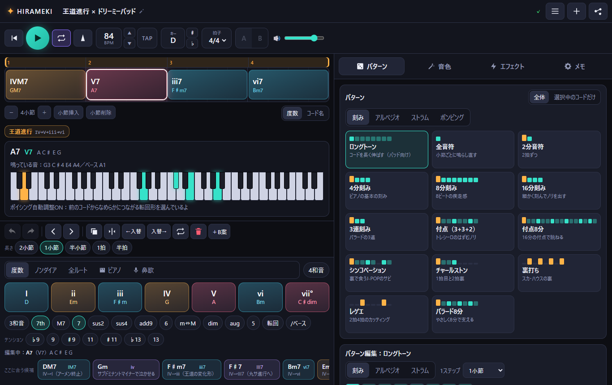
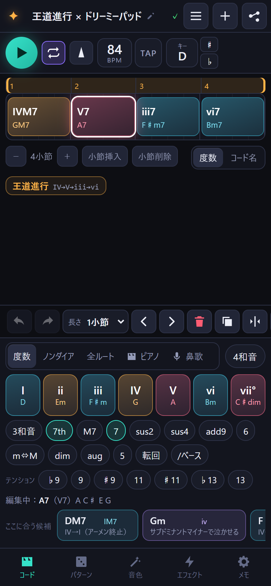

# ✦ HIRAMEKI — 即興コードメモ

ふと思いついた「最高のコード進行」を、その場でメモして**すぐ鳴らせる** Web アプリ。
Vital 風のウェーブテーブル・シンセと、コード進行用シーケンサーとエフェクトが 1 つになってる。
細かい作曲は DAW で。このアプリは「**アイデアを逃さない・雰囲気がすぐわかる**」ためのもの。

- PC（マウス・キーボード）／スマホ・タブレット（縦画面・タッチ）両対応
- サーバー不要：`dist/` をどこに置いても動く静的ファイル（GitHub Pages などにそのまま置ける）
- PWA：ホーム画面に追加でき、一度開けばオフラインでも動く
- データはすべて自分の端末のブラウザ内（IndexedDB）に自動保存。URL 共有・JSON で持ち運べる

**▶ すぐ使う：https://zenhansha.github.io/hirameki/** （スマホなら開いて「ホーム画面に追加」でアプリっぽく使える）

 

---

## 使い方（30秒）

1. **キーとテンポ**を上のバーで決める（キーボタン横の ♯ / ♭ でワンタップ移調）
2. 下の**度数ボタン**（I・ii・iii…）をタップ。ボタンには今のキーでのコード名（C, Dm…）も出てる。タップするたびに右へ進む
3. 入れたコードは **7th / M7 / sus4 / add9 / 転回 / テンション** などのチップでアレンジ
4. **パターン**（刻み・アルペジオ・ストラム・ポンピング）、**音色**、**エフェクト**を選んで ▶

ほかにも：
- タイムラインのコードを**タップで選択** → 置き換え・長さ変更・分割・複製・削除。**横ドラッグで入れ替え**
- **小節番号のバーをドラッグ**するとループ範囲になる（タップならそこから再生）
- 「**＋B案**」で 1 つのコードに別案を作って、上の **A / B** で聴き比べ
- 「次の候補」は有名進行の続き（例：IV→V のあとに「王道進行の続き」で iii）も教えてくれる

迷ったら **＋ →「テンプレートから作成」**。王道進行・カノン進行・丸サ進行・小室進行・Just the Two of Us 進行・ポップパンク・食い（アンティシペーション）・循環コード・12小節ブルース・ワルツ・6/8バラード・センシティブ進行の **12 種類**を ▶ で試聴して、気に入ったら「これで作る」で新しいメモになる（テンプレート自体は一覧に入らないし、変わらない）。初めて開いたときだけ「王道進行 × ドリーミーパッド」が開いた状態になってるよ（触らなければ保存されない）。

## 起動方法

| やりたいこと | 方法 |
|---|---|
| ふつうに使う | https://zenhansha.github.io/hirameki/ を開く |
| PC でローカルに | `start_hirameki.bat` をダブルクリック → `http://localhost:8790/`（`dist/` がない時は先に `build.bat`） |
| 更新を公開する | `git push` するだけ。GitHub Actions がテスト → ビルド → GitHub Pages に公開（`.github/workflows/pages.yml`） |
| ほかの場所に置く | `dist/` フォルダの中身をそのままアップロード（https 必須） |
| claude.ai の中で使う | Artifact 版：https://claude.ai/artifact/1wnYWY3vfQ92w4aV7fGNzi （最初は自分だけが開ける。人に見せる時はページの共有メニューから） |
| Artifact 版を作り直す | `npm run build:artifact` → `artifact/index.html` と `artifact/assets/*.js` を Artifact として公開 |

**Artifact 版の違い**：メモは claude.ai アカウントの自分専用の保存領域（他の人には見えない）に入るので、ブラウザを変えても残る。WAV / MIDI は claude.ai が保存を許していない形式なので **ZIP に入れて**保存する（開くと中に .wav / .mid）。マイク（鼻歌入力）と MIDI 機器は claude.ai の中では使えないので、その時は Web 版へのボタンが出る。「URLで共有」のリンクは Web 版を開くリンクになる。
| ソースを直して試す | `dev.bat`（開発サーバー `http://localhost:5173/`） |
| 作り直す | `build.bat`（`dist/` を更新） |
| テスト一式 | `test.bat`（ユニット → ビルド → E2E） |

> ⚠ `index.html` を**ダブルクリックで直接開く（file://）と音が出ない**よ。音声エンジン（AudioWorklet）は https か localhost でしか動かないブラウザの決まりがあるから。必ず上の方法で開いてね。

コマンドで：`npm install` → `npm run dev` / `npm run build` / `npm test` / `npx playwright test`

---

## 実装した機能一覧

### 1. 全体
- PC・スマホ・タブレットのブラウザ対応（Chrome / Edge / Safari / iOS Safari / Android Chrome）
- **iOS の最初のタップで確実に鳴らす**：タップの瞬間に AudioContext を作って `resume()` ＋無音バッファ再生。iOS 17+ は `navigator.audioSession.type = 'playback'` でマナースイッチ ON でも鳴る（古い iOS は無音の `<audio>` ループで同じ効果）。最初のタップで押したコードも、エンジン起動を待ってからちゃんと鳴らす
- PWA（manifest ＋ 自前の Service Worker。ビルド時に全ファイルをプリキャッシュ）。オフラインで AudioWorklet が読めない場合はキャッシュから Blob で読み込むフォールバック付き

### 2. 再生・テンポ
- BPM（上下ドラッグ / タップで直接入力 / ▲▼）、**TAP テンポ**
- 拍子 2/4・3/4・4/4・5/4・6/8・7/8・9/8・12/8（6/8 などは付点4分を1拍として扱う）
- 小節数変更、ループ ON/OFF、ループ範囲（ルーラーをドラッグ or メモ画面で数値）
- 再生 / 停止 / 先頭へ、キー（24調）、マスター音量、スウィング（8分 / 16分）、ヒューマナイズ（タイミング・強さのゆらぎ。ループのたびに揺れ方が変わる）、メトロノーム（小節頭・拍で音程を変えた3段階）
- **タイミングは AudioWorklet の中で 1 サンプル単位でスケジュール**。メイン画面が重くなってもリズムがもたつかない（下の「しくみ」参照）

### 3. シンセサイザー（Vital 風）
- **オシレーター 3 基**（ウェーブテーブル 10 種：ベーシック〔サイン→三角→ノコギリ→矩形〕、ウォーム、パルス幅、オルガン、ボイス〔あ→え→い→お→う〕、FM、エレピ、ハーモニックスイープ、グラス、ホロウ）。**ポジション**でテーブル内をモーフィング。ベーシックはサイン/三角/ノコギリ/矩形のワンタップボタン付き
- 各オシレーター：音量・オクターブ・半音・微調整・パン・**ユニゾン（最大8）・デチューン・広がり**（スーパーソーが作れる）・位相ランダム
- ノイズ、**フィルター**（LP24 / LP12 / HP / BP / ノッチ、カットオフ・レゾナンス・ドライブ・キー追従、周波数特性グラフ表示）
- **エンベロープ 3 つ**（ENV1＝音量、ENV2/3 はモジュレーション用、ADSR グラフ表示）
- **LFO 3 つ**（7 波形、Hz またはテンポ同期、フリー／毎回リセット、位相、フェードイン）。テンポ同期 LFO は小節頭に揃う
- **モジュレーション**：色つきチップ（ENV2・ENV3・LFO1〜3・VEL・KEY・RAND・MOD ホイール）を**ノブにドラッグ＆ドロップ**、または**チップをタップ → 光ったノブを上下ドラッグ**で量を決める（Vital と同じ考え方。ノブの外周に色リングで変調範囲が出る）。一覧からの量調整・削除も可
- **プリセット 16 種**（ドリーミーパッド、ウォームパッド、スーパーソー、プラック、ベル、エレピ、ストリングス、オルガン、ガラスキー、Lo-Fi キー、チップチューン、クワイア、シンセブラス、ソフトピアノ、アンビエント、ホロウパッド）＋ベース 6 種＋メロディ 2 種。全部、同じパターンで鳴らしたときの音量が ±1dB 程度にそろえてある
- **自作音色の保存・呼び出し・削除**（マイ音色）。コード / ベース / メロディ のパートごとに編集
- **何音重ねても割れない**：和音の音数に応じた音量補正（√(3/音数)）、ボイス数上限＋古い音から 4ms フェードで奪う（クリックしない）、同じ音の再発音は同じボイスを使い回す、パートごとの余裕、最後にリミッター
- 短い音符（アルペジオなど）では自動でアタックを短くするので、ゆっくり立ち上がるパッドでもちゃんと聞こえる

### 4. コード入力
- **度数ボタン**：I〜vii°（短調は i〜VII）。**ボタンに「V」と「G」の両方**を表示、機能ごとに色分け（トニック青・サブドミナント橙・ドミナント赤・ノンダイアトニック紫）。「4和音」で 7th 付き入力
- **変化チップ**：3和音 / 7th（キーに合った7th）/ M7 / 7 / sus2 / sus4 / add9 / 6 / m⇔M / dim / aug / 5 / **転回**（ベース音が順に変わる）/ **/ベース**（分数コード）／**テンション** ♭9 9 ♯9 11 ♯11 ♭13 13
- **ノンダイアトニック**：セカンダリードミナント（V/V, V/vi, V/ii, V/IV, V/iii）、借用和音（iv, ♭VI, ♭VII, ♭III, iiø7, v, ♭II…）、経過和音（♯ivø7, ♯i°7, I+ など）、短調用（V, vii°7, ドリアンの IV …）。それぞれ一言解説つき
- **全ルート**：12音 × 12種のコードを直接選べる（コード名で考えたい時に）
- **ピアノモード**：鍵盤で好きな音を選ぶ → コード名を自動判定（C/E、F/G、C7(9)…）→ その**押さえ方のまま**入力。コードを選ぶとその構成音が鍵盤に読み込まれて、1音ずつ直せる
- **鼻歌入力**【推奨】：マイクで歌った音程を YIN 法で推定。①1音歌って「この音をルートに入力」②ループに合わせて歌って録音 → **メロディとして保存**（タイムラインにピンクの線で表示・MIDI にも書き出し）／**メロディに合うコードを小節ごとに自動入力**（ビタビ法）／キーの推定
- 長さ：2小節・1小節・半小節・1拍・半拍（拍子に合わせて変化）。入力前の長さも、選択中のコードの長さも変えられる
- 編集：置き換え・削除・**並べ替え（左右入替 / ドラッグ）**・**複製**（後ろを自動でずらす）・分割・**結合**・小節の挿入/削除・範囲選択（Shift／小節番号をダブルタップでその小節を全選択／Ctrl+A）・**コピー / 切り取り / 貼り付け**・**削除して詰める**
- **リズムまわりの気づかい**（「半拍が2つ並んだらどう鳴る？」を全部考えた）
  - **タイ**：同じコードが続くと（半拍＋半拍、小節またぎ など）1 つの音として伸ばす。鳴らし直さないのでリズムがつながる。タイムラインに ⌒ 印。OFF にもできる（パターン → グルーヴ、その他メニュー）
  - **食い（アンティシペーション）**：選んだコードを半拍（6/8 などは 8 分）前から鳴らす。前のコードが半拍短くなる。「食いを戻す」も
  - **結合**：2 つ以上選んで 1 つに、または 1 つ選んで「次のコードと結合」。分割の逆
  - **アルペジオは短いコードでも途切れない**：小節の途中から始まるコードは、前のコードの続きの音からアルペジオを続ける（半拍コードが毎回いちばん下の音に戻って単調にならない）
  - **どんなに短いコードも必ず鳴る**：裏打ちパターンなどで拍のすき間に入った短いコードにも 1 回は音を出す
  - **挿入モード**：途中に入力すると後ろのコードを押し出す（OFF＝上書き。Insert キーかその他メニュー）
  - **自動ズーム**：短いコードがあると 1 行の小節数を自動で減らして、指で押せる大きさを保つ（手動で 1/2/4/8 小節も選べる）
  - 長さを伸ばして後ろのコードを上書きしたときは「元に戻す」付きでお知らせ
- **アンドゥ／リドゥ**（200 手。ノブのドラッグは 1 手にまとまる）
- **度数表示 ⇔ コード名表示** の切替（タイムライン右下）、度数の書き方 `ii7` 式 / `IIm7` 式
- **ワンタップ移調**（♯ / ♭ ボタン、`[` `]` キー）。キー変更時に「コードも移調 / 音はそのままで度数だけ読み替え」を選べる
- **ボイシング自動調整**（前のコードからの指の移動が最小になる転回形・ドロップ2 を自動選択。ON/OFF）。PC では鳴っている音を鍵盤で表示
- **進行の名前判定**：王道進行、丸サ進行（Just the Two of Us 進行）、カノン進行（前半も）、小室進行、センシティブ進行、ポップパンク（Let It Be）進行、50s、循環コード、逆循環、ツーファイブワン、アンダルシア、Creep、456、サブドミナントマイナー終止、マリオ終止、ミクソリディアン終止、ブルース、枯葉、Fly Me to the Moon … 短調は平行調の度数で、別キーの進行も検出。ループの継ぎ目をまたいだものも見つける。バッジに触れるとタイムライン上で範囲が光る
- **次のコード候補**：機能和声のルール＋有名進行の続き。選択中のコードには「ここに合う候補」（今のコード以外）を出す

### 5. パターン
- **刻み**（全音符・2分・4分・8分・16分・3連・付点（3+3+2）・付点8分・シンコペーション・チャールストン・裏打ち・レゲエ・バラード8分）
- **アルペジオ**（上昇・下降・往復×2・ランダム・外→内、開始音、オクターブ幅 1〜4、速さ＝1ステップの長さ）
- **ストラム**（下から・上から・交互、速さ ms）
- **ステップ編集**：マス目をタップで「・→音→アクセント→伸ばす」。1ステップの長さ、ゲート、強さ、アクセント、音域、「コード頭で必ず鳴らす」
- **ポンピング（キックなしサイドチェイン）**：周期・深さ・カーブ・戻る長さ・タイミング、カーブ表示。エフェクトの**後**にかかるのでリバーブごとうねる
- プリセット 30 種（刻み 14 / アルペジオ 9 / ストラム 5 / ポンピング 4）
- **コード × パターン × 音色の自由な組み合わせ**：パターンは「全体」か「選択中のコードだけ」に適用できる（個別パターンのコードには ♪ マーク）
- **自動ベースライン**：ルート（ロング）/ ルート4分 / ルート8分 / オクターブ / ルート＋5度 / **ウォーキング**（次のコードへ半音で寄る）/ シンコペーション / パターンに合わせる。ON/OFF・音色・音域・音量
- **A/B 比較**：コードごとに B 案（コードもパターンも）。A/B ボタンで再生しながら即切り替え、「B を採用」

### 6. エフェクト
- **好きな数だけ重ね掛け（最大 12）**：追加・削除・順番入れ替え・同じ種類を何個でも。各エフェクトに **ON/OFF と Dry/Wet**
- 種類：**リバーブ**（量・サイズ・減衰・プリディレイ・ハイカット・ローカット）、**ディレイ**（テンポ同期の長さ・フィードバック・ピンポン・トーン）、**コーラス / フランジャー / フェイザー**、**ディストーション**（ソフト / ハード / チューブ / ビットクラッシュ。歪ませても音量が上がりすぎないよう自動補正）、**EQ**（ロー/ミッド/ハイ）、**フィルター**（LP/HP/BP、テンポ同期の揺れ付き）、**コンプレッサー**、**ステレオ幅**
- 最終段に**ルックアヘッド・リミッター常時 ON**（-0.5dBFS を絶対に超えない）＋長時間の音量暴走を抑えるラウドネスガード。出力メーター付き
- **雰囲気プリセット 12 種**（ドライ / ルーム / ホール / ドリーミー / Lo-Fi / ワイド / シネマティック / ヴィンテージ / エコー / シューゲイザー / クラブ / 80s）。切り替えても音量差 ±3dB 以内に調整済み
- **自作チェーンをプリセット保存**、メモごとにチェーン保存（チェーンはメモ全体で 1 系統）
- **軽量モード**（自動 / 高音質 / 軽量）：同時発音数 28→12、ユニゾン上限 8→3、制御レート 1/2、リバーブ長の上限、フェイザー段数、歪みのオーバーサンプリングを下げる。「自動」は音声スレッドの負荷が 65% を超えたら自動で切り替え

### 7. メモ管理
- 保存（**自動保存**：入力の 0.6 秒後＋タブを閉じる/隠す時）・一覧・呼び出し・**削除（確認ダイアログ＋直後なら元に戻せる）**・複製
- 各メモ：タイトル・タグ・ひとことメモ・お気に入り・テンポ・キー・拍子・小節数・ループ・スウィング・ヒューマナイズ・音色（3パート）・パターン・ベース・ポンピング・エフェクト・メロディ
- **アプリを開くとすぐ新しいメモ**（前回のメモは「開く」ボタン付きでお知らせ）
- **一覧から直接 ▶ 再生**、検索（タイトル・コード・タグ・メモ）、タグ絞り込み、お気に入り、並び順
- **URL 共有**：メモを圧縮（deflate）して URL の `#` 以降に入れる。開くとそのまま復元＆一覧に保存（`#` 以降はサーバーに送られないのでプライバシー的にも安心）。スマホは共有シート、PC はクリップボードにコピー
- **JSON エクスポート / インポート**（1件・全件。マイ音色・マイ FX も同梱。ID が重なるものはコピーとして取り込むので上書き事故なし）
- **将来のクラウド同期を見越したデータ設計**：全データにバージョン番号、メモごとに不変の `id`・`createdAt`・`updatedAt`・`rev`（保存ごとに +1）・削除は墓標（`deleted`）で 30 日保持。`src/store/repo.ts` に `SyncAdapter` インターフェース（pull/push）を用意済み。保存層は `src/store/db.ts` の Backend に集約

### 8. 連携・書き出し
- **MIDI ファイル**（SMF type 1）：テンポ・拍子・調号・コード名マーカーのトラック＋**コード / ベース / メロディを別トラック**。「パターンを反映（聴こえた通り）」か「コードを伸ばしたまま」を選択、ループ回数指定
- **WAV**：OfflineAudioContext で**エフェクト込み**・リミッター込み・残響の余韻まで（16bit / TPDF ディザ）。再生と同じエンジンなので音が同じ
- **Web MIDI 入力**：MIDI キーボードで弾くとシンセが鳴る／**弾いた和音をそのままコード入力**／サステインペダル・モジュレーションホイール対応／**MIDI ラーン**（パッドやボタンに「再生」「1度のコード」「元に戻す」などを割り当て）。非対応ブラウザ（iOS Safari など）では MIDI の設定欄自体が出ない
- **キー割り当て**：全コマンドにキーボードのキーを追加できる。左手デバイス（KASUMI など ZMK のキーボード）が送る `F13`〜 のキーもそのまま割り当て可能

### キーボードショートカット（PC）
| キー | 動作 | キー | 動作 |
|---|---|---|---|
| Space | 再生 / 停止 | Enter | 頭から再生 |
| 1〜7 | 度数のコード入力 | Shift+1〜7 | 3和音/4和音を逆にして入力 |
| Q / W / E / R | 7th / M7 / sus4 / add9 | Y / I | m⇔M / 転回 |
| ← / → | 前後のコードへ | Shift+← / → | コードを入れ替え |
| Delete / Backspace | 削除 | Ctrl+D | 複製 |
| J | 結合 | Alt+← / Alt+→ | 半拍前に食う / 戻す |
| Ctrl+C / X / V | コピー / 切り取り / 貼り付け | Ctrl+A | すべて選択 |
| Shift+Delete | 削除して詰める | Insert | 挿入モード ON/OFF |
| Alt+N / Alt+T | 空のメモ / テンプレートから作成 | Alt+L | メモ一覧 |
| Ctrl+Z / Ctrl+Y | 元に戻す / やり直す | `,` / `.` | 長さを短く / 長く |
| `[` / `]` | 半音下 / 上に移調 | L / M / T / B | ループ / メトロノーム / タップ / A⇔B |
| P | ピアノ入力 | ? | ヘルプ |

---

## しくみ（勉強用メモ）

**全体構成** — Vite + TypeScript + Preact（軽い React 互換 UI）＋ Preact Signals（状態管理）。ビルドすると静的ファイルだけになる。

```
src/theory/   音楽理論（コード構成音・綴り・度数表記・ボイシング・コード判定・進行判定・候補）… 全部純粋関数でテスト済み
src/seq/      タイムライン編集・パターン生成・ベース生成・メモ→演奏データへの「コンパイル」
src/audio/    ウェーブテーブル生成、AudioWorklet（シンセ＋シーケンサー＋リミッター）、エフェクト、WAV 書き出し
src/store/    データ形式（バージョン・移行）、IndexedDB 保存、インポート/エクスポート
src/io/       MIDI 書き出し、WAV エンコード、URL 共有、Web MIDI
src/hum/      鼻歌の音程推定（YIN）とメロディ→コード推定
src/ui/       画面（タイムライン、コードパッド、シンセ画面、パターン、FX、メモ、一覧）
```

- **なぜシーケンサーを AudioWorklet の中に置いたか**：ふつうの Web アプリは `setTimeout` で少し先の音を予約するけど、画面が重いと予約が遅れて「もたつく」。HIRAMEKI は演奏データ一式を音声スレッドに渡して、**音声スレッド自身がサンプル単位で発音**する。UI が固まっても演奏はズレない。編集すると新しいデータを送るだけで、再生は止まらずに反映される
- **ウェーブテーブルとエイリアシング**：高い音でギラついたノイズ（折り返し）が出ないよう、テーブルを **半オクターブごとに倍音を減らした版（ミップマップ）** で 21 段持っていて、鳴らす高さに合わせて選ぶ。生成は FFT で倍音から合成
- **フィルター**は TPT 型 SVF（モジュレーションで激しく動かしても壊れにくい）。異常値が出たら自動リセット
- **リミッター**は 4ms 先読み：「必要な音量の下げ幅」の区間最小値をとってから平均化するので、ピークが来る前にもう音量が下がっている（数学的にはみ出さない）。ユニットテストで +20 倍のスパイクを入れても天井を超えないことを確認
- **ボイシング自動調整**は、候補（各転回形・ドロップ2 × オクターブ）を全部作って「前の和音からの移動量＋音域の中心からのズレ＋低音のにごり」を点数化して一番いいものを選ぶ
- **コード判定**は、各音をルート候補にして全コードタイプと照合 → 余った音はテンション、ベース音は転回形 or 分数コードとして点数化（例：G-F-A-C は「G11」ではなく「F/G」と読む）
- **進行判定**は、同じコードの連続をまとめてから、度数（平行長調の基準）＋メジャー/マイナーでパターン照合

## テスト

- **ユニットテスト 153 件**（`tests/unit/`、Vitest）
  - 音楽理論：綴り（F の IV は B♭、F♯メジャーの E♯、G♯マイナーの F𝄪）、度数表記 2 方式、7th/sus/テンション/転回/分数、コード判定、ボイシング（全12キーで音域内・自動の方が移動が少ない）、進行判定（王道・丸サ・カノン・小室・平行調・ループの継ぎ目・別キー）、次の候補、移調
  - シーケンス：上書き入力・分割・入替・複製・小節挿入削除・結合・食い・削除して詰める・コピペ（上書き/挿入）・タイ（同じコードは鳴らし直さない）・アルペジオの継続・短いコードが必ず鳴ること、パターン（3/4・6/8・3連・小節をまたぐ伸ばし・休符と retrig・ゲート）、全プリセットが全拍子で範囲内、ベース全スタイル、スウィング、A/B、データ修復と移行
  - 音声：**Node 上でワークレットの DSP をそのまま動かして**、鳴りっぱなしゼロ、ボイス上限、クリック検出、テンポ変更中の動作、サンプル精度のタイミング（±64 サンプル）、リミッターの天井、NaN 排除、帯域制限
  - 書き出し：MIDI を書いて自前パーサーで読み戻し、WAV ヘッダ、共有 URL の往復と壊れた URL、インポート、鼻歌（YIN の精度・音符化・キー推定・コード付け）
- **E2E テスト 12 シナリオ**を **PC 幅 1366px とスマホ幅 390px（タッチ）**で実行（計 22 回。MIDI とキー割り当ては PC のみ）（`tests/e2e/`、Playwright、Windows 標準の Edge を使うので追加ダウンロード不要）
  - 新規メモ → コード入力 → 7th → アンドゥ/リドゥ → 複製 → パターン（アルペジオ）→ エフェクト追加 → 再生（**実際に音が出ていて、ピーク 0.95 以下**をメーターで確認）→ タイトル → 自動保存 → 一覧に表示 → **一覧から再生** → 検索 → **URL 共有を別ページで開いて復元** → **MIDI / WAV 書き出し**（ファイルの中身まで検査）
  - 初回起動、テンプレートから作成（試聴→作成→一覧に 1 件）、半拍コードのタイ・結合・食い、削除の確認と取り消し、JSON 全件書き出し→読み込み、キーボード操作、ピアノ入力、A/B 比較、コード個別パターン、ルーラーでループ範囲、MIDI 入力と MIDI ラーン、キー割り当て（F13）、**オフライン起動（PWA）**
- 音のチェック：開発用の解析ツール（`src/dev/analyze.ts`, `src/dev/viz.ts`）で全プリセット × パターン × エフェクトを書き出して、音量・ピーク・クリック・残響の切れ方を数値と画像で確認。最悪ケース（スーパーソー16分など）でも音声スレッドの負荷は PC で 1 コアの約 4%

## 既知の制限

- **鼻歌入力**はハミング・はっきりした単音向け。和音・伴奏が鳴っている環境・極端に低い/高い声は拾いにくい（ヘッドホン推奨）。リズムは 16 分で丸める
- iOS Safari などは **Web MIDI 非対応**（ブラウザ側の制限）。設定欄は自動で隠れる
- 同期はまだない（端末間は URL 共有か JSON で）。ブラウザのデータを消すとメモも消えるので、大事なメモは JSON で書き出しておいてね
- プライベートモードや一部の古い Safari では保存できないことがある（画面に案内が出る）
- iOS 16 以前は、マナースイッチ対策の無音 `<audio>` のせいでロック画面に再生中表示が出ることがある
- WAV は 16bit / 44.1kHz 固定、MIDI のヒューマナイズ（ゆらぎ）は書き出さない
- リバーブは計算で作ったインパルス応答（実在の部屋のサンプリングではない）
- 軽量モードの「自動」切り替えは音声スレッドの処理時間の概算（ミリ秒精度）で判断している
- 1 メモ最大 256 小節、エフェクト最大 12 個

## 今後の改善案

- クラウド同期（`SyncAdapter` を Firebase / Supabase で実装、`rev` と `updatedAt` で衝突解決）
- メロディトラックの手入力・編集（ピアノロール）、ドラムパターン
- セクション（A メロ / サビ）単位の整理、コード進行のテンプレート挿入
- 音色のランダマイズ・モーフィング、ウェーブテーブルの自作（画像や音声から）
- 実機 iPhone / Android での長時間プロファイリングと、それに合わせた軽量モードの自動しきい値調整
- WAV 24bit / ステム（コード・ベース別）書き出し、MusicXML 書き出し
- 共有 URL の QR コード表示（スマホ→PC がもっと楽に）
- 英語 UI
